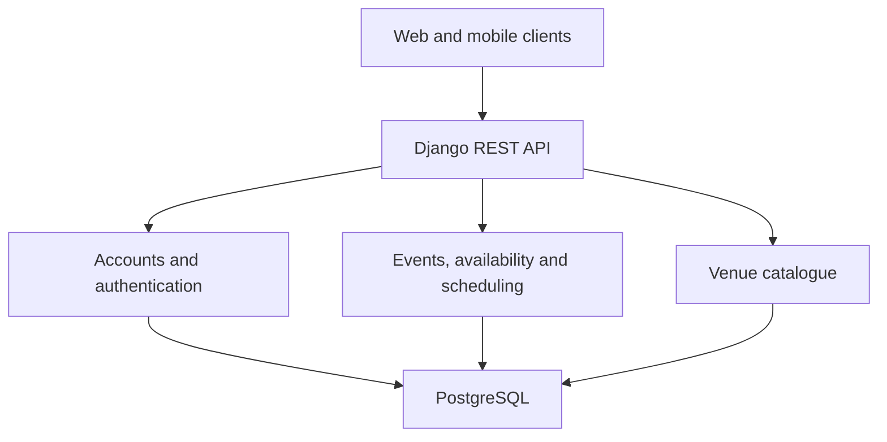

# itsaplan

A group-planning application that brings availability, activity preferences and venue choice into one flow for arranging an outing.

The project began as a **research practicum** and is now being developed by a **six-person team towards release in Dublin**. I am the **Backend Lead, Product Owner and Scrum Master**.

**Current position:** the backend foundation and the first planning stage are implemented and merged into `development`. Venue recommendations, shared venue swiping and final-plan generation remain the main product work ahead.

## About this repository

This is a public project case study. Our application source repository remains private while the team develops the product for release in Dublin. Here, I describe my responsibilities, the backend design, implemented functionality and the remaining work.

This repository contains documentation only. Application source, environment configuration and local setup instructions are maintained in the team's private repository.

*Development status snapshot: 24 October 2026.*

## The problem

Arranging a group outing involves several connected decisions: when people are available, what they want to do, what atmosphere they prefer and which venue works for everyone. Those decisions often become scattered across messages and repeated polls.

itsaplan aims to turn that discussion into a structured planning journey. The Dublin design targets two main participant interactions after the organiser sets up an event:

1. **Use 1: contribute inputs.** Join the event, confirm availability and submit activity-category and busyness preferences.
2. **Use 2: choose a venue.** Swipe through a shared, ordered venue deck once the time and recommendations have been resolved.

The intended outcome is one saved time and venue that every participant can view. The second stage and final outcome are still being built.

## Research origins and product direction

The research practicum established the initial group-planning concept and prototype. The Dublin product develops that work further, with a revised interaction flow and a local venue catalogue.

The earlier prototype's area-busyness work used Manhattan data. A Dublin busyness signal requires its own data, definition and evaluation. The current venue catalogue includes storage for predictions; Dublin recommendation logic and model validation remain separate work.

Availability and busyness have different roles: availability describes people's schedules, while busyness captures their preferred surrounding atmosphere for an outing.

## My contribution

**Summer research practicum:** I implemented the entire backend for the original project.

**Dublin continuation:** I am the Backend Lead and have implemented all backend work completed to date. Alongside implementation, I hold Product Owner and Scrum Master responsibilities and use **Shortcut** for sprint and task logging.

Frontend development, product design, machine learning and business research are also part of the wider team's work.

| Role | Responsibility |
| --- | --- |
| **Backend Lead** | Lead the Django backend and implement the completed backend functionality, including architecture, security, API contracts and integration. My remit also covers infrastructure and backend acceptance as the product moves towards release. |
| **Product Owner** | Write acceptance criteria for many of the team's tasks, prioritise and order the backlog in Shortcut, and translate product decisions into implementation priorities focused on a complete planning journey. |
| **Scrum Master** | Use Shortcut for sprint and task logging, schedule team meetings and resolve delivery blockers, keeping planned work and implementation progress visible across the six-person team. |

My backend implementation spans identity and account flows, event membership and lifecycle rules, availability and scheduling, venue data, email delivery, administration and automated testing. The table below summarises the Dublin backend I have implemented so far and the work still to complete.

## Implemented backend

| Area | Implemented | Remaining or separate work |
| --- | --- | --- |
| **Accounts and authentication** | Registration, email verification, login/logout, token refresh, browser cookie authentication, account details and email/password changes. | Complete client integration and validate the release journey. |
| **Events and Use 1** | Event creation, automatic organiser membership, shared invitations, category/busyness votes, explicit member completion, early closure and deadline handling. | Expose organiser preferences in event/join responses and connect the outcome to recommendations. |
| **Availability and scheduling** | Manual calendars, reusable routines, confirmed availability, Dublin timezone and daylight-saving handling, ranked time suggestions and fallback outcomes. | Settle and implement final-time selection. |
| **Venue catalogue** | Venue models, provenance, features, prediction storage, discovery/import and export tools. | Implement venue ranking and connect it to the group's time and preferences. |
| **Email and waitlist** | Public waitlist, welcome/verification emails, delivery tracking and retry support. | Event lifecycle notifications. |
| **Groups** | Group and membership models. | User-facing group API and workflow. |
| **Backend tooling** | Django admin, migrations, documented APIs, development Swagger and automated tests. | Complete operational integration and release validation. |

## Backend architecture

The core backend uses **Python, Django, Django REST Framework and PostgreSQL**, with documented APIs and development Swagger.

Django owns identity, permissions, event state, availability and the data needed by later planning stages. The diagram groups responsibilities within the backend; client integration remains part of the MVP work.

The backend design separates request handling, validation, business rules and persistence. Views coordinate requests, serializers define and validate API contracts, services hold workflow logic, and models describe stored data and relationships. This gives event and scheduling rules a consistent home as more clients and planning stages are connected.

## Engineering decisions

### Model the planning workflow explicitly

Membership, participant completion, early closure and deadlines influence what an event can do next. These rules belong in the backend so each client follows the same planning process. The implemented Use 1 foundation provides the starting point for the remaining transitions.

### Separate availability input from confirmation

Saving calendar data and explicitly completing availability are distinct actions. This gives the workflow a clear signal that a participant has finished contributing their inputs, while supporting manual calendars and reusable routines.

### Treat Dublin time as a scheduling requirement

Scheduling needs to respect local dates and daylight-saving changes in `Europe/Dublin`. Ranked time suggestions and fallback outcomes are already implemented; choosing and persisting the final time is the next part of that workflow.

### Establish venue data before ranking

The catalogue models venue features, provenance and prediction storage independently of recommendation logic. This creates a traceable data foundation for the ranking work and allows discovery, import and export tools to be developed alongside it.

### Give the group one shared basis for venue selection

The planned Use 2 flow uses one shared, ordered deck. Recommendation order also provides a basis for deterministic tie-breaking. Persisting the deck and the eventual final plan will let every participant see a consistent result. This is a design direction for the remaining implementation.

## Validation and current limits

The latest reported full backend test run was:

**679 passed.**

Automated tests, API documentation and migrations are established in the private application repository. This figure records the development suite result at this status snapshot.

PostgreSQL concurrency coverage remains unverified locally. Hosted deployment and migration status have not been checked for this update. The remaining work also includes validating the complete journey across the connected clients and backend.

## Remaining planning MVP work

1. **Expose organiser preferences** in event and join responses.
2. **Connect Use 1 to recommendations:** settle final-time selection and preference aggregation, then use category and busyness inputs in venue ranking.
3. **Build Use 2:** persist the shared ordered deck, record members' swipes and apply the agreed completion and tie-break rules.
4. **Record the final plan:** persist the selected time and venue and expose the same result to all participants.
5. **Finish operational integration:** schedule deadline processing, add event lifecycle notifications, connect the clients and validate the complete journey.

This case study will be updated as those milestones are completed.
